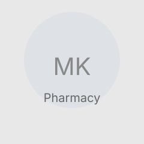

# Mahfuza Siddika Khan – Academic Portfolio

A clean, responsive, single-page academic portfolio website built with **HTML5, CSS3, and vanilla JavaScript** only. Designed to be mobile-first, light/dark friendly, and academia-professional. No frameworks (React, Vue, Angular, Bootstrap, Tailwind) — pure web standards.

## Live Demo (GitHub Pages)

You can view the hosted site at: **https://<your-username>.github.io/<repo-name>**  
(Replace `<your-username>` and `<repo-name>` with your GitHub details after pushing.)

---

## Folder Structure

```
portfolio/
├── index.html          ← main portfolio page
├── style.css           ← stylesheet with color palette, theme toggle, responsive design
├── script.js           ← vanilla JavaScript for theme toggle, mobile menu, smooth scroll, nav highlights
├── README.md           ← this file
└── assets/
    ├── images/
    │   ├── profile-placeholder.jpg     ← replace with your profile photo
    │   └── research-poster-placeholder.svg ← replace with your research poster image
    │
    ├── documents/
    │   ├── Mahfuza_Siddika_Khan_CV.pdf       ← replace with your actual CV PDF
    │   ├── ICAAD_2026_Poster.pdf             ← replace with your ICAAD 2026 poster PDF
    │   ├── Silver_Explorer_Award_Certificate.pdf ← replace with your award certificate PDF
    │   ├── Mitosis_Study_Guide.pdf           ← replace with your study guide PDF
    │   └── Preterm_Infants_Research_Roadmap.pdf ← replace with your research roadmap PDF
    │
    └── icons/         ← custom icons (favicon, social media icons)
```

## Color Palette

- **Navy Blue:** `#0f0f2f` (primary accents, navigation, headings)
- **Blue:** `#3b82f6` (links, secondary accents, topic chips)
- **Sky Blue:** `#60a5fa` (hover states, highlights, active states, theme toggle)
- **Charcoal:** `#333333` (body text, readability)
- **White:** `#ffffff` (card backgrounds, light mode)

The stylesheet uses CSS custom properties (variables) in the `:root` selector for easy customization.

## How to Replace the Profile Photograph

1. Add your photo file to `assets/images/`
2. Supported formats: JPG, PNG, WebP, SVG
3. Recommended size: at least 200x200px (displayed at 240x240px with border)
4. Update the HTML if you use a different filename:

```html
<!-- Before -->


<!-- After (if you name your file differently) -->

```

The CSS already targets `assets/images/profile-placeholder.svg`, so naming your file `profile-placeholder.svg` will auto-use it, or just update the `src` attribute.

## How to Edit Personal Information

### Hero Section (index.html)
- Name: Change the `<h1 class="hero__name">Mahfuza Siddika Khan</h1>` text
- Tagline: Modify `<p class="hero__tagline">...</p>`
- Introduction: Edit `<p class="hero__description">...</p>`
- Buttons: Change the "Explore My Research" and "Get in Touch" link text/about

### About Me Section (index.html)
- Edit the paragraph text under `.about__text`
- Replace the profile photo in `.about__photo`

### Education Section (index.html)
- Update degree, institution, department, period, and current status text

### Research Interests (index.html)
- Edit the tag pills under `.research__tags`

### All Other Sections
- Open `index.html` and search for placeholder text marked with `[` and `]`
- Replace with your actual information

## How to Add Research Poster PDFs

1. Place your PDF file in `assets/documents/`
2. The poster link appears in Project 2 (Women's Health and PCOS Poster)
3. Update the placeholder link in the HTML:

```html
<!-- In the projectCard for Project 2 -->
<p>[ADD POSTER PDF]</p>
<!-- Change to -->
<p><a href="assets/documents/ICAAD_2026_Poster.pdf" download class="btn btn--secondary">View Poster PDF</a></p>
```

Or keep the placeholder format and update the text.

## How to Add Certificates

1. Place your certificate PDF in `assets/documents/`
2. The awards section has one award slot (Silver Explorer Award)
3. To add or modify awards, edit the `.awards__list` section in `index.html`
4. Update the award institution text and year

## How to Add the CV PDF

1. Place your CV PDF in `assets/documents/` as `Mahfuza_Siddika_Khan_CV.pdf`
2. The "Download CV (PDF)" button automatically links to this file
3. If the file doesn't exist, the button will show a "file not found" behavior from the browser
4. Update the `href` in the CV section if you use a different filename

## How to Update LinkedIn, ORCID, and Google Scholar Links

1. Edit the contact social links in `index.html`:

```html
<!-- LinkedIn -->
<a href="https://www.linkedin.com/in/your-profile-id/" class="contact__socialLink" aria-label="LinkedIn">
  LinkedIn
</a>

<!-- ORCID -->
<a href="https://orcid.org/your-orcid-id" class="contact__socialLink" aria-label="ORCID">
  ORCID
</a>

<!-- Google Scholar -->
<a href="https://scholar.google.com/your-profile" class="contact__socialLink" aria-label="Google Scholar">
  Google Scholar
</a>
```

2. The same links appear in the mobile navigation menu.

## How to Preview the Website Locally

### Option 1: Using Python (built-in)
1. Open a terminal/command prompt
2. Navigate to the `portfolio/` directory
3. Run: `python -m http.server 8000`
4. Open `http://localhost:8000` in your browser

### Option 2: Using Node.js (if installed)
1. Navigate to the `portfolio/` directory
2. Run: `npx serve` or `npx http-server`
3. Open the displayed URL in your browser

### Option 3: Using VS Code Live Server
1. Open the `index.html` file in VS Code
2. Right-click and select "Open with Live Server"
3. Or click the "Go Live" button in the bottom right

## How to Upload Changes Using GitHub Desktop

1. Open GitHub Desktop and select your repository
2. Review changes in the "Changes" tab
3. Enter a commit summary describing your updates
4. Click "Commit to main"
5. Click "Push origin" to upload to GitHub

## How to Publish Through GitHub Pages

### Option A: User/Organization Pages
1. Create a new repository named `yourusername.github.io`
2. Push all files (including the `portfolio/` subdirectory) to the `main` branch
3. Go to **Settings** → **Pages** → **Source**: select the `main` branch / `(root)` folder
4. The site will be published at `https://yourusername.github.io`

### Option B: Project Pages (within any repository)
1. Create any repository name (e.g., `academic-portfolio`)
2. Push all files to the repository
3. Go to **Settings** → **Pages** → **Source**: select the `main` branch / `/ (root)` folder
4. The site will be published at `https://yourusername.github.io/academic-portfolio`

### Custom Domain (optional)
1. In GitHub Pages settings, set a custom domain
2. Create a `CNAME` file in the repository root with your domain name (e.g., just `mahfuza-portfolio.com`)
3. Configure DNS settings with your domain provider (A records or CNAME)

---

## Customization Tips

### Changing the Color Palette
Edit the CSS variables in `style.css` `:root` selector:

```css
:root {
  --navy: #your-color;
  --blue: #your-color;
  --sky-blue: #your-color;
  --charcoal: #your-color;
  --white: #your-color;
}
```

### Adding More Projects
Copy the `.projectCard` HTML structure and modify:
- Title and description
- Tags and status badge
- Conference/info details
- Placeholder links

### Adding More Skills
Add `.skillItem` elements within the appropriate `.skillCategory` in the skills section.

### Dark Mode
The website automatically respects `prefers-color-scheme`. A theme toggle button is in the navbar. Saved preferences are stored in `localStorage`.

---

## License

This project is open source under the **MIT License**. Feel free to fork, modify, and use it as a template for your own academic portfolio.

## Beginner Checklist

Before publishing, verify:

- [ ] Profile photograph replaced in `assets/images/`
- [ ] CV PDF added to `assets/documents/` or download link updated
- [ ] Research poster PDF linked or placeholder updated
- [ ] Certificate PDF added or award text updated
- [ ] LinkedIn, ORCID, and Google Scholar links updated
- [ ] All placeholder text `[...]` replaced with actual information
- [ ] Email address (mahfuzasiddikakhan@gmail.com) is correct
- [ ] All internal navigation links work
- [ ] Mobile menu opens/closes properly
- [ ] Theme toggle works (light/dark)
- [ ] Scroll reveals animate elements into view
- [ ] Active navigation links highlight on scroll
- [ ] No broken links or missing file references
- [ ] Responsiveness tested on mobile, tablet, and desktop